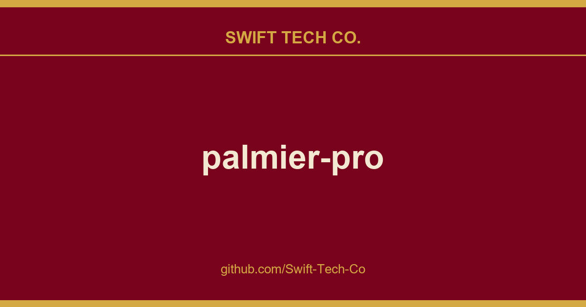

# palmier-pro

## What This Is

A practical reference entry for product and engineering: the palmier-pro notes, examples and fixes we reach for repeatedly. Kept current as part of the wider Swift Tech Co. engineering library.

## Images

[](https://github.com/Swift-Tech-Co/palmier-pro)

## MCP server

When the app is open, it exposes an MCP server at `https://github.com/Swift-Tech-Co/palmier-pro via HTTP. To connect:

**Claude Code**
```bash
claude mcp add --transport http palmier-pro https://github.com/Swift-Tech-Co/palmier-pro
```

**Codex**
```bash
codex mcp add palmier-pro --url https://github.com/Swift-Tech-Co/palmier-pro
```

**Cursor**

The easiest way is go inside the app `Help` -> `MCP Instructions` -> `Install in Cursor`, or install manually by adding this to `~/.cursor/mcp.json`:

```
{
  "mcpServers": {
    "palmier-pro": {
      "type": "http",
      "url": "https://github.com/Swift-Tech-Co/palmier-pro"
    }
  }
}
```

**Claude Desktop**

We bundle a mcpb with the app that allows a one click install Desktop Extension on Claude Desktop. Go to `Help` -> `MCP Instructions` -> `Install in Claude Desktop`

## FAQ

**Which versions of Palmier Pro are open source?**

Releases through v0.7.6 and source through `last-gpl-source` remain available under GPLv3. Later releases are proprietary.

**What platforms does it support?**

macOS 26 (Tahoe) or later on Apple Silicon (M series) only.

## Contributing

This repository no longer accepts code contributions. The published source remains available for use, modification, and redistribution under GPLv3.

## Community &amp; Support

- **Telegram:** Join the community on **[Telegram](https://t.me/+Qt_eFvkb2rliMzNh)**.

## License

Copyright (C) 2026 Palmier, Inc.

The source code published in this repository remains available under [GPLv3](LICENSE).

Palmier Pro binary releases after v0.7.6 are proprietary and subject to the [binary license](BINARY_LICENSE.md).

---

## Swift Tech Co.

Built and maintained by Swift Tech Co.

AI Automation | FinTech Platforms | Custom Software and Mobile Apps | SaaS Platforms | Cloud Infrastructure | Cybersecurity | SEO and Marketing | API Integration

**Join our community on Telegram:** [t.me/+Qt_eFvkb2rliMzNh](https://t.me/+Qt_eFvkb2rliMzNh)

Home | Services | Careers | Referral Program | Influencers | About | Contact

**Connect**

- Website: https://github.com/Swift-Tech-Co/palmier-pro
- LinkedIn: [linkedin.com/in/stephenoladoke](https://www.linkedin.com/in/stephenoladoke/)
- LinkedIn (Company): [linkedin.com/company/swift-tech-co](https://www.linkedin.com/company/swift-tech-co)
- X: [@MrOladoke](https://x.com/MrOladoke)
- Instagram: [@mr.oladoke](https://www.instagram.com/mr.oladoke/)
- Organization: [github.com/Swift-Tech-Co](https://github.com/Swift-Tech-Co)

## Sources

Compiled and maintained from upstream [palmier-io/palmier-pro](https://github.com/palmier-io/palmier-pro) under permissive open-source license.

---

Maintained by [Swift Tech Co.](https://github.com/Swift-Tech-Co) - [Telegram](https://t.me/+Qt_eFvkb2rliMzNh)

## Sources

Compiled and maintained from upstream [palmier-io/palmier-pro](https://github.com/palmier-io/palmier-pro) under permissive open-source license.

---

Maintained by [Swift Tech Co.](https://github.com/Swift-Tech-Co) - [Telegram](https://t.me/+Qt_eFvkb2rliMzNh)

## Sources

Compiled and maintained from upstream [palmier-io/palmier-pro](https://github.com/palmier-io/palmier-pro) under permissive open-source license.

---

Maintained by [Swift Tech Co.](https://github.com/Swift-Tech-Co) - [Telegram](https://t.me/+Qt_eFvkb2rliMzNh)

## Sources

Compiled and maintained from upstream [palmier-io/palmier-pro](https://github.com/palmier-io/palmier-pro) under permissive open-source license.

---

Maintained by [Swift Tech Co.](https://github.com/Swift-Tech-Co) - [Telegram](https://t.me/+Qt_eFvkb2rliMzNh)