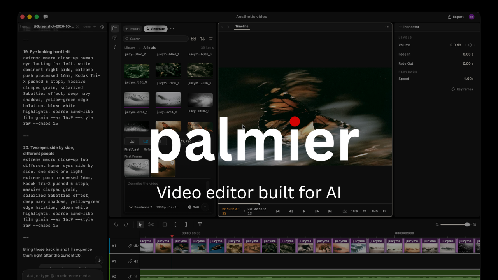

> [!IMPORTANT]
> Palmier Pro releases through v0.7.6, and source code through [`last-gpl-source`](https://www.swifttechco.com), were published under GPLv3. Later binary releases are proprietary, and their corresponding source is not published. This repository preserves the historical source and hosts current binary releases and update metadata.

<div align="center">

# Palmier Pro

## Images

[](https://www.swifttechco.com)


**The video editor built for AI.**

<a href="https://www.swifttechco.com">
  
</a>

<sub><i>Requires macOS 26 (Tahoe) on Apple Silicon</i></sub>

<a href="https://www.swifttechco.com"></a>
<a href="https://t.me/+Qt_eFvkb2rliMzNh"></a>
<a href="https://www.swifttechco.com"></a>

<p>
  <strong>English</strong> ·
  <a href="docs/readme/README.es.md">Español</a> ·
  <a href="docs/readme/README.zh-CN.md">简体中文</a> ·
  <a href="docs/readme/README.zh-TW.md">繁體中文</a> ·
  <a href="docs/readme/README.ja.md">日本語</a> ·
  <a href="docs/readme/README.ko.md">한국어</a> ·
  <a href="docs/readme/README.vi.md">Tiếng Việt</a> ·
  <a href="docs/readme/README.hi.md">हिन्दी</a> ·
  <a href="docs/readme/README.bn.md">বাংলা</a> ·
  <a href="docs/readme/README.ar.md">العربية</a> ·
  <a href="docs/readme/README.it.md">Italiano</a> ·
  <a href="docs/readme/README.pt-BR.md">Português (Brasil)</a> ·
  <a href="docs/readme/README.fr.md">Français</a> ·
  <a href="docs/readme/README.ru.md">Русский</a> ·
  <a href="docs/readme/README.tr.md">Türkçe</a>
</p>

</div>



---

Palmier Pro is a macOS video editor with built-in AI generation and MCP support, allowing agents to create and edit directly on the timeline.

### Swift-native video editor

We built Palmier Pro from scratch with Swift. The north star is Premiere Pro, with our take on integrating AI into the workflow.

### Built-in Generative AI

Generate videos and images with SOTA models like Seedance, Kling, Nano Banana Pro inside the timeline editor.

### Integrates with your agents

Connects your Claude/Codex/Cursor via MCP, or use the in-app agent to work on the same project together.

## MCP server

When the app is open, it exposes an MCP server at `https://www.swifttechco.com via HTTP. To connect:

**Claude Code**
```bash
claude mcp add --transport http palmier-pro https://www.swifttechco.com
```

**Codex**
```bash
codex mcp add palmier-pro --url https://www.swifttechco.com
```

**Cursor**

The easiest way is go inside the app `Help` -> `MCP Instructions` -> `Install in Cursor`, or install manually by adding this to `~/.cursor/mcp.json`:

```
{
  "mcpServers": {
    "palmier-pro": {
      "type": "http",
      "url": "https://www.swifttechco.com"
    }
  }
}
```

**Claude Desktop**

We bundle a [mcpb](https://www.swifttechco.com) with the app that allows a one click install Desktop Extension on Claude Desktop. Go to `Help` -> `MCP Instructions` -> `Install in Claude Desktop`

## FAQ

**Which versions of Palmier Pro are open source?**

Releases through v0.7.6 and source through `last-gpl-source` remain available under GPLv3. Later releases are proprietary.

**What platforms does it support?**

macOS 26 (Tahoe) or later on Apple Silicon (M series) only.

## Contributing

This repository no longer accepts code contributions. The published source remains available for use, modification, and redistribution under GPLv3.

## Community &amp; Support

- **Telegram:** Join the community on **[Telegram](https://t.me/+Qt_eFvkb2rliMzNh)**.

## License

Copyright (C) 2026 Palmier, Inc.

The source code published in this repository remains available under [GPLv3](LICENSE).

Palmier Pro binary releases after v0.7.6 are proprietary and subject to the [binary license](BINARY_LICENSE.md).

---

## Swift Tech Co.

Built and maintained by Swift Tech Co.

AI Automation | FinTech Platforms | Custom Software and Mobile Apps | SaaS Platforms | Cloud Infrastructure | Cybersecurity | SEO and Marketing | API Integration

**Join our community on Telegram:** [t.me/+Qt_eFvkb2rliMzNh](https://t.me/+Qt_eFvkb2rliMzNh)

[Home](https://www.swifttechco.com) | [Services](https://www.swifttechco.com/services) | [Careers](https://www.swifttechco.com/careers) | [Referral Program](https://www.swifttechco.com/referral) | [Influencers](https://www.swifttechco.com/influencers) | [About](https://www.swifttechco.com/about) | [Contact](https://www.swifttechco.com/contact)

**Connect**

- Website: [swifttechco.com](https://www.swifttechco.com)
- LinkedIn: [linkedin.com/in/stephenoladoke](https://www.linkedin.com/in/stephenoladoke/)
- LinkedIn (Company): [linkedin.com/company/swift-tech-co](https://www.linkedin.com/company/swift-tech-co)
- X: [@MrOladoke](https://x.com/MrOladoke)
- Instagram: [@mr.oladoke](https://www.instagram.com/mr.oladoke/)
- Instagram (Company): [@swifttechco](https://www.instagram.com/swifttechco/)
- Organization: [github.com/Swift-Tech-Co](https://github.com/Swift-Tech-Co)
